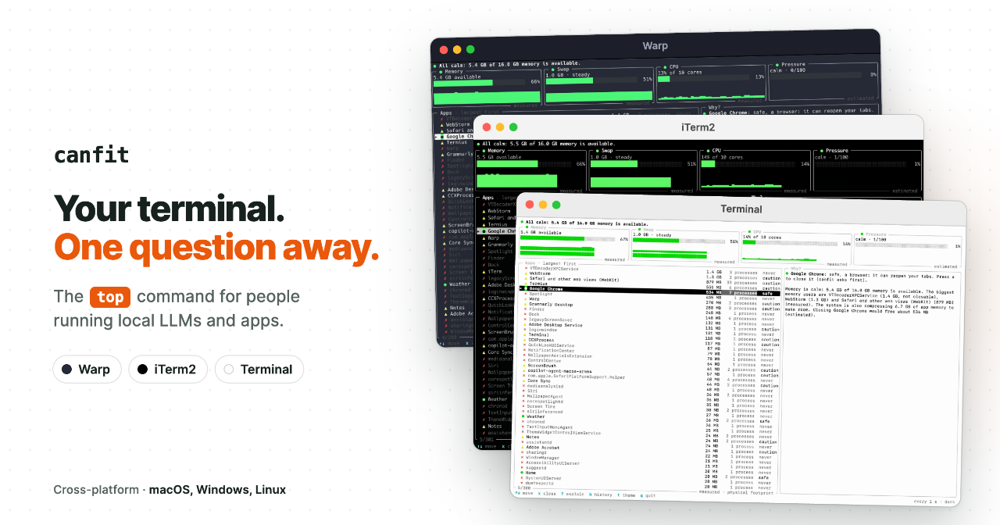

<div align="center">

<!-- Logo: docs/assets/canfit-logo.svg (class "canfit-logo", 5rem text). GitHub strips class/style
     attributes from README HTML, so the size lives inside the SVG and in height="80". -->
<p align="center" class="canfit-logo">
  
</p>

<h3>The  command for people running local LLMs and apps</h3>

<p>
  
  <a href="LICENSE"></a>
  <br>
  
  
  
</p>

Can I launch this model — or this app — right now? If not, what should I close?
canfit answers in plain language — answers, not tables.

[Install](#install) · [Quick start](#quick-start) · [Documentation](#explore-the-documentation) ·
[How it compares](#how-it-compares)

<a href="https://www.producthunt.com/products/canfit?embed=true&amp;utm_source=badge-featured&amp;utm_medium=badge&amp;utm_campaign=badge-canfit" target="_blank" rel="noopener noreferrer"></a>

</div>

## What is canfit?

People running local inference (llama.cpp, Ollama, LM Studio) and heavy apps (Docker Desktop,
virtual machines, IDEs) hit the same wall: the memory free **right now** may not be enough, it is
unclear which processes are eating it, and nobody knows what is safe to close — so they reboot.

canfit is a cross-platform system monitor that, besides showing RAM, CPU and pressure, answers:

- [**Can this model fit right now?**](docs/open-source/usage.md#can-this-model-fit-right-now)
- [**Is there room for this app?**](docs/open-source/usage.md#is-there-room-for-this-app)
- [**How much does it really use?**](docs/open-source/usage.md#how-much-does-it-really-use)
- [**What should I close?**](docs/open-source/usage.md#what-should-i-close)
- [**Why is my machine slow?**](docs/open-source/usage.md#why-is-my-machine-slow)
- [**What happened while I was away?**](docs/open-source/usage.md#what-happened-while-i-was-away)

Each answer is described in [Usage](docs/open-source/usage.md#what-canfit-answers).

Every number says whether it was **measured**, **read from config** or **estimated**. Estimates are
conservative and never presented as measurements.

## Explore the documentation

| Using canfit | How it works |
|---|---|
| [Installation](docs/open-source/installation.md) | [Architecture](docs/open-source/architecture.md) |
| [Usage](docs/open-source/usage.md) | [Memory estimation](docs/open-source/estimation.md) |
| [Apps](docs/open-source/apps.md) | [Pressure index](docs/open-source/pressure-index.md) |
| [Process safety](docs/open-source/process-safety.md) | [Development](docs/open-source/development.md) |
| | [Third-party notices](docs/open-source/THIRD_PARTY_NOTICES.md) |



<!-- Demo GIF: record the "doesn't fit → close Chrome → now it fits" flow, save it as
     docs/assets/canfit-demo.gif and replace this comment with:
     <p align="center"></p> -->

## Watch the demo

<a href="https://youtu.be/AziPJdnVwuo" target="_blank" rel="noopener noreferrer">
  
</a>

<a href="https://youtu.be/AziPJdnVwuo" target="_blank" rel="noopener noreferrer">Watch the canfit demo on YouTube</a>.

## Install

One self-contained binary for macOS, Windows and Linux: no runtime, no admin rights, no telemetry.
On Linux it is a static binary that runs on **any distribution — e.g. Ubuntu, Debian, Fedora, Arch
Linux, Alpine**.

**macOS and Linux**

```bash
curl --proto '=https' --tlsv1.2 -LsSf https://github.com/federicolaterra/canfit/releases/latest/download/canfit-installer.sh | sh
```

**Windows** (PowerShell)

```powershell
powershell -ExecutionPolicy Bypass -c "irm https://github.com/federicolaterra/canfit/releases/latest/download/canfit-installer.ps1 | iex"
```

**Package manager**

```bash
# macOS, Linux — Homebrew (the formula lives in this repository)
brew tap federicolaterra/canfit https://github.com/federicolaterra/canfit
brew install federicolaterra/canfit/canfit

# Windows — Scoop (no bucket needed)
scoop install https://raw.githubusercontent.com/federicolaterra/canfit/master/packaging/scoop/canfit.json

# Rust developers — from the repository
cargo install --git https://github.com/federicolaterra/canfit --tag v1.0.0 --locked
```

`.deb`, `.rpm`, `.msi` and plain archives are attached to every
[release](https://github.com/federicolaterra/canfit/releases/latest). Update, uninstall, checksums
and unsigned-binary notes: [Installation](docs/open-source/installation.md).

## Quick start

```bash
canfit                          # live monitor: what's using memory, and how much pressure
canfit qwen3-14b-q4_k_m.gguf    # can this model fit right now? (exit 0 fits, 1 tight, 2 doesn't fit)
canfit model.gguf --ctx 32768   # ...with a 32k context
canfit model.gguf --make-room   # if not, what should I close? (closes only after you confirm)
canfit "Docker Desktop"         # is there room for this app? (from the memory its settings declare)
canfit "UTM: Ubuntu"            # ...or for one virtual machine
canfit Slack                    # ...or for any app: from what canfit measured it use, or its catalog
canfit "Docker Desktop" model.gguf   # several things together: one total, one answer
canfit free                     # the apps safest to close, largest first
canfit models ~/models          # which of my GGUF files fit right now
canfit history                  # the pressure events of the last 24 hours, and their culprits
canfit --no-history             # any command, recording nothing in this run
canfit watch -- llama-server -m model.gguf   # run it, measure its real memory, remember the peak
canfit --json                   # everything above has --json for scripts
```

## Exit codes

| Exit code | Meaning |
|---|---|
| `0` | Fits |
| `1` | Fits, but tight / will slow down (swap, compression) |
| `2` | Doesn't fit (for apps: at risk) |
| `3` | canfit could not complete the request: a missing, unreadable, truncated or malformed model file, an unknown or ambiguous app name (no settings, history or catalog value), app settings it could not read with no history or catalog to fall back on, an unreadable `apps.toml`, a failed or unconfirmed `canfit update`, an unreadable config file, a folder `models` can't read, a history database it must not touch (newer or not canfit's), or an OS it can't read yet |
| `64` | Invalid command-line usage |

## How it compares

canfit is the only tool we know of that combines a live cross-platform monitor, a "can I launch
it now?" check for models **and** apps and a safe "what to close" advisor in the terminal. Each of these tools
does its own job well:

| | canfit | btop / bottom / htop | llmfit | gguf-parser | Rig |
|---|---|---|---|---|---|
| Live system monitor | ✓ terminal | ✓ terminal | — | — | web dashboard |
| Model fit against memory available **now** | ✓ GGUF | — | total hardware | static estimate | ✓ |
| App fit (Docker, VMs, IDEs from settings; other apps from history or catalog) | ✓ | — | — | — | — (lists running apps by memory) |
| Measure a command's real peak memory (`watch`) | ✓ whole process tree | — | — | — | — |
| Memory estimate | calibrated, labelled estimate | — | against total hardware | **most detailed** (canfit validates against it) | file size + flat KV cache |
| Says what to close, and closes it with confirmation | ✓ | manual kill | — | — | lists apps, never closes |
| History of pressure events | ✓ local | — | — | — | — |
| Platforms | macOS, Windows, Linux | macOS, Windows, Linux (varies by tool) | CLI | CLI | macOS on Apple Silicon only |

Based on each project's documentation as of November 2026; corrections are welcome. canfit does
not read NVIDIA or AMD VRAM yet (Apple Silicon unified memory is covered). None of the others
checks whether an app such as Docker Desktop, a virtual machine or an IDE fits right now. Use **btop** for a
richer general-purpose dashboard, **gguf-parser** for the most detailed static
estimate of a GGUF file and its offload split, and **llmfit** to choose models for your hardware.
Use **canfit** when the question is "can I launch it *now*, and if not, what do I close?".

## Community and open source

canfit is open-source software under the [MIT License](LICENSE). Contributions and responsible
feedback are welcome:

- [Contributing](.github/CONTRIBUTING.md)
- [Issues](https://github.com/federicolaterra/canfit/issues)
- [Code of Conduct](.github/CODE_OF_CONDUCT.md)
- [Security Policy](.github/SECURITY.md)
- [Support](.github/SUPPORT.md)
- [Changelog](docs/open-source/CHANGELOG.md)
